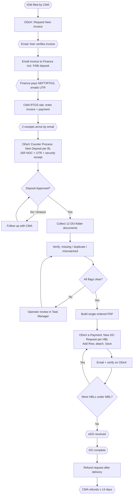
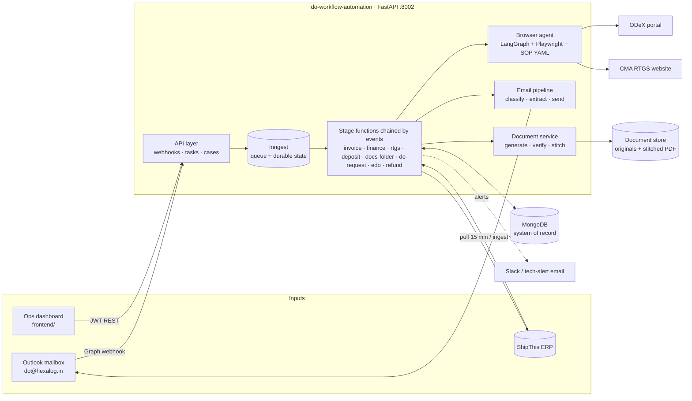
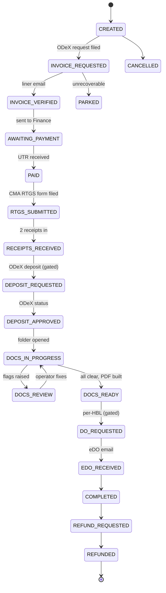

# DO Workflow Automation — High-Level Design (HLD)

| | |
|---|---|
| Status | Draft v0.2 — aligned to the engine's real orchestration pattern (see [ENGINE-REUSE.md](ENGINE-REUSE.md)) |
| Source process | `DO PROCESS FLOW E2E.xlsx` (CMA CGM Delivery Order — SOP, DO folder collection, flow diagram) |
| Reference architecture | `logistics-platform-1/python-brain` (Inngest + FastAPI + MongoDB + LangGraph/Playwright browser agent + Outlook Graph + ShipThis ERP) |
| Companion | [LLD.md](LLD.md) · [ENGINE-REUSE.md](ENGINE-REUSE.md) (what to copy from `python-brain`) · [REPO-STRUCTURE.md](REPO-STRUCTURE.md) (decided repo layout) |

---

## 1. Purpose

A Delivery Order (DO) is the release document the shipping line (CMA CGM) issues so the consignee can take delivery of an ocean shipment. Today Hexalog's Customs Ops runs the DO process by hand across **four systems and two mailboxes**: ODeX (the liner portal), the CMA RTGS website, e-mail, and the bank. It is slow, repetitive and error-prone — a wrong HBL number, a missing receipt or a mismatched document sends the whole request back.

This design automates the process end to end using the same platform model as `logistics-platform-1`:

| Capability | Used for |
|---|---|
| **Browser agent** (LangGraph + Playwright, YAML SOPs) | ODeX and CMA RTGS website work: request invoice, deposit request, refund request, DO request + upload |
| **Email** (Microsoft Graph in, classifier, Graph send out) | Receive liner invoice / UTR / receipts / endorsed DO; forward invoice to Finance; chase CMA |
| **ShipThis** (ERP connector) | Shipment master data in (MBL, HBLs, container, vessel, consignee, CHA); documents, status and tasks back |

> **Assumption:** "shix" in the request is read as **ShipThis**, the ERP used by `logistics-platform-1`. Confirm.

## 2. Scope

**In scope** — everything in the SOP:

1. Request DO invoice on ODeX after CMA's IGM is filed.
2. Send the liner-verified invoice to Finance (₹40k security deposit); capture the UTR once Finance pays.
3. Enter invoice + payment details on the CMA RTGS website; receive the two receipts by e-mail.
4. ODeX Counter Process → **Deposit request** (per BL), with JSR NOC, UTR, security receipt → wait for *Deposit Approved*.
5. **DO folder**: collect the 12 documents (system-generated + e-mail), verify them against the shipment, flag Missing / Duplicate / Mismatched, operator review, build one ordered PDF, keep an audit trail.
6. ODeX → e-Payment → **New DO Request** per HBL, upload folder via *Add Row*, send e-mail, verify on ODeX, receive the eDO.
7. **Refund request** after delivery (ODeX → Deposit and Refund → Request Refund) and tracking of CMA's 14-day refund SLA.

**Out of scope (v1)** — paying the deposit (Finance keeps NEFT/RTGS in the bank portal), liners other than CMA CGM (the design keeps liner-specific parts behind a config/SOP boundary so a second liner is additive), customs filing (already handled by `python-brain`).

## 3. Actors

| Actor | Role |
|---|---|
| **Customs Ops** | Reviews flagged documents, approves gated steps, resolves exceptions in the Task Manager |
| **Finance (Kishan)** | Pays the deposit via NEFT/RTGS, e-mails the UTR and receipts |
| **CMA CGM** | Verifies invoice, approves deposit, issues the eDO (via ODeX + e-mail) |
| **Automation (this system)** | Everything else |

## 4. Process → automation map

The flow diagram in the workbook is the spine. Each box becomes a workflow stage; every human or external wait is event-driven (a task approval, an inbound e-mail, or a delayed event), not a poll loop in code.

Legend: rectangles = automated action; hexagons = external wait (e-mail / person / liner); diamonds = decision.

## 5. Architecture

Same shape as `python-brain`: one FastAPI process, Inngest as queue/step runner, MongoDB as system of record. No Celery/Redis/RabbitMQ. **The engine is copied from `python-brain`, not redrawn** — only the use case (ocean DO instead of air customs) is new; see [ENGINE-REUSE.md](ENGINE-REUSE.md) for exactly what is copied, replaced and new, and [REPO-STRUCTURE.md](REPO-STRUCTURE.md) for where it lives.

### 5.1 Components

| Component | Responsibility | Reuse from `python-brain` |
|---|---|---|
| **Frontend (ops dashboard)** | Cases board, case timeline, document review (G3), approvals (G2/G4/refund), HITL inbox, SLA view — talks only to the backend API via a client generated from its OpenAPI schema | new (`frontend/`); API/auth conventions from `python-brain`'s Task Manager |
| **API layer** | Graph webhook, ops/task endpoints, admin ingest, health | `api/routers/*`, JWT auth, same conventions |
| **Inngest workflows** | One small function per stage, chained by typed events (`customs/do.*`); state is the Mongo record + Task list; waits use the task gate, reply-detection events and delayed follow-up events — there is no master orchestrator | factory pattern `create_*_function(client)`, `EventNames` constants |
| **Browser agent** | Runs SOP YAML on ODeX / CMA RTGS | `agents/browser/*` as-is (Playwright-only SOPs; Browserbase optional) |
| **Email pipeline** | Ingest, classify (rules → LLM), extract (UTR, invoice no., receipts), send/forward, chase | `connectors/outlook*`, `services/llm/*`, HITL hidden-span reply pattern |
| **Document service** | Render system documents from templates, classify attachments, verify, flag, stitch | `pdf_stitcher`, `document_reader`, Extend.ai webhook flow, `weasyprint_pdf` |
| **ShipThis connector** | Read shipment master data; write documents, status, tasks | `connectors/shipthis*`, `erp_outbox` |
| **Task Manager** | Ops approvals and review queue | `task_gate.wait_for_task_approval`, `Task` model, `/tasks/*` |
| **Cross-cutting** | HITL, idempotency, locks, alerts, logging | `HitlRequest`, `IdempotencyKey`, `shipment_lock`, `alerts`, structlog |

### 5.2 Why this shape

- **Event chaining fits the process.** Large parts of the DO flow are waiting on people and the liner (Finance pays, CMA approves, eDO arrives — hours to days). Each arrival (an e-mail, a task approval) is an event that triggers the next stage, so nothing sits in a loop and a crash loses no in-flight state — it lives in MongoDB. Chasing is a delayed event with an attempt counter, as the checklist follow-up does today.
- **Browser work is deterministic.** ODeX and the RTGS site are fixed forms. Playwright SOPs (zero LLM calls on the hot path) are cheaper and more reliable than agentic browsing; the LLM-backed Stagehand path stays as an opt-in fallback only.
- **E-mail is both a trigger and an artifact source.** The same ingest that classifies a message also files its attachments into the right case folder, so e-mail-sourced documents (HBL, MBL, receipts, endorsed DO) arrive without manual download.
- **Money and irreversible submissions are gated.** Deposit submission and final DO submission sit behind ops approval gates (see §7) until the process has earned trust.

## 6. Case model (summary)

One **DO case** per MBL; one **DO request** per HBL under it. Full schema in the LLD. The states below are a *projection* of milestones recorded in MongoDB (as `python-brain` does for shipments), written through one `transition` function — not an in-memory saga. Whether the record is a `do` sub-document on the existing `Shipment` or a separate `do_cases` collection is a pending decision (ENGINE-REUSE §4.1; this repo's default is the separate collection because DO has its own lifecycle).

## 7. Human-in-the-loop and approval gates

| Gate | Why | Mechanism |
|---|---|---|
| **G1 — Send to Finance** (optional, off by default) | Wrong invoice → wrong payment | `wait_for_task_approval` |
| **G2 — Submit ODeX deposit request** | Financial; wrong BL split is costly to unwind | `wait_for_task_approval` |
| **G3 — Document review** | Mandatory when any flag is Missing / Duplicate / Mismatched; the SOP forbids upload until flags are cleared | `wait_for_task_approval` + flag list; resolves via Task Manager |
| **G4 — Submit DO request** | Irreversible once submitted to the liner | function triggered by `customs/task.completed` for the task (the `cmc_transmit` pattern — no timeout to outlive) |
| **HITL** | Email cannot be matched to a case; OCR confidence low; ODeX field not found | `HitlRequest` + hidden-span reply, same as `python-brain` |

Gates G1/G2/G4 are configuration, not code, so they can be relaxed per client once accuracy is proven (`requires_ops_confirmation` on the task seed, as in `python-brain`).

## 8. Integrations

| System | Direction | Mechanism | Notes |
|---|---|---|---|
| **ODeX** | read/write | Playwright SOPs | Login per run; one session per case; selectors versioned in YAML |
| **CMA RTGS website** | write | Playwright SOP | Receipts return by e-mail to the address typed in the form — use a dedicated mailbox / tag so they route to the case |
| **Outlook (Graph)** | in + out | Webhook + subscription renewal; send via Graph | Mailbox reconciliation sweep for missed notifications |
| **ShipThis** | in + out | httpx connector | In: MBL, HBLs, container, vessel/voyage, consignees, CHA, Job No. Out: documents, status, tasks |
| **Extend.ai / OCR** | in | Async webhook | Classify and read attachments (HBL, MBL, receipts) for verification |
| **Slack / tech alert** | out | Existing alert service | Failures, SLA breaches |

## 9. Cross-cutting concerns

- **Idempotency.** Every side effect (ODeX submit, e-mail send, ERP write, RTGS submit) is guarded by an insert-once `IdempotencyKey` claim in `scope:key` form (`do_invoice:{mbl}`, `do_deposit:{mbl}:{bl}`, `do_request:{hbl}`…), the same `claim_*` / `fail_*_claim` helpers the CMC functions use. An Inngest replay or a re-fired event can never double-submit a payment form.
- **Audit trail.** Original source files are never mutated; every document keeps source, hash, received-at, verification result and who cleared a flag. Every state transition is an append-only `do_events` record.
- **Security.** ODeX / RTGS / ShipThis credentials in env/secret store only; PII and bank details redacted from logs (`log_redaction`); JWT on all ops endpoints; document store is private.
- **Observability.** structlog JSON per service, Grafana/Loki stack from `observability/`, per-case timeline in the dashboard, SLA timers (invoice pending, deposit approval pending, eDO pending, refund > 14 days).
- **Failure model.** Browser SOP failure → `NonRetriableError` + alert + HITL task (re-fire to resume), matching `python-brain`. Recovery is the engine's documented drill: verify the real state in the portal, delete the failed claim key, re-send the original event. Money steps (RTGS, deposit) are never blindly retried — they re-read the portal's own record first.
- **Configurability.** Document list, sources, order, signatory/stamp rules, matching rules, gates, SLA timers and mailbox addresses live in config/YAML, not code (SOP requirement 6).

## 10. Deployment

A monorepo (`backend/` + `frontend/`, this repo) deployed as its own stack — the backend in its own container (`python:3.12-slim` + uv + Chromium runtime) next to MongoDB 7, the frontend as a static build behind the same reverse proxy — independent of `python-brain`'s deploys; Inngest Cloud in prod, `inngest dev` locally; optional Browserbase for the remote browser. CI: ruff, mypy (strict), pytest — already scaffolded in this repo.

## 11. Delivery plan

| Phase | Deliverable | Exit criterion |
|---|---|---|
| **0** Foundations (incl. `backend/` conversion, `frontend/` scaffold + generated API client) | Case model, state machine, API, ShipThis read, Task Manager wiring | A case can be created from ERP and advance with manual task completion |
| **1** Documents | Document collection, verification, flags, PDF stitching (Deliverable 2) + frontend document-review screen | Folder PDF for a real shipment matches ops' manual one |
| **2** Browser SOPs | ODeX invoice request, deposit request, DO request + upload | Dry-run against ODeX with gates on |
| **3** Email loop | Ingest + match + forward to Finance + UTR/receipt capture + chase | Zero-touch from invoice email to receipts filed |
| **4** Refund + SLAs | Refund SOP, 14-day tracking, dashboards (SLA view in the frontend) | End-to-end case closed without manual keying |
| **5** Hardening | Relax gates per client, second liner, load/soak | Pilot client at gates off for a month |

## 12. Open questions & assumptions

1. **"shix" = ShipThis?** Assumed.
1a. **Repo model — decided: B (own repo, engine copied) as a monorepo with `backend/` and `frontend/`.** Alternative A (a module inside `python-brain`) was rejected for independent deploy/blast radius; cost accepted: two copies of the engine to keep in sync. Revisit if drift hurts. See [REPO-STRUCTURE.md](REPO-STRUCTURE.md).
1b. **Sea support in the ShipThis connector.** The connector's air surface is much richer than its sea surface (`get/list/update_sea_shipment`, `upload_sea_document` only). Confirm which sea endpoints and document categories DO needs.
2. **Document count mismatch.** The SOP says *"All 8 documents are mandatory"* and gives a PDF order for 8; the collection sheet lists **12** (adds Endorsed DO, NOC for DO [HEXALOG], Authorization Letter, Checklist, and splits NOC for DO into [CHA]/[HEXALOG]). Need the authoritative list, which are mandatory, and the PDF order for items 9–12.
3. **NOC party.** SOP step says "JSR Group's NOC" for the deposit; the document sheet says "JAI SHRI" / "JAY SHRIRAM DARBAR LOGISTICS (P) LTD" as CHA and HEXALOG for the second NOC. Confirm they are the same party and where each template comes from.
4. **ODeX / RTGS access.** Login method, MFA/OTP, session timeouts, concurrency limits, whether a sandbox exists. A CAPTCHA/OTP on either site changes the design (HITL step).
5. **Receipt routing.** Can the RTGS form's e-mail field take a plus-address / dedicated mailbox, and does it accept a free-text reference (case id)?
6. **Finance handoff.** Is e-mail to Finance + "Mail from Kishan" with the UTR the only channel, or is there a bank/ERP feed to read the UTR from?
7. **Multiple BLs under one MBL.** The SOP repeats D1–D2 per HBL and fills one deposit entry per BL. Confirm whether the deposit is per BL or per MBL, and how the ₹40k maps.
8. **Refund trigger.** What event starts the refund (BL delivered / container returned / DO expiry)?
9. **eDO delivery.** Does ODeX or only e-mail deliver the eDO? Needed for the "verify on ODeX" step.
10. **Source of truth for system-generated documents.** Templates for Bond, NOC, Authorization Letter, Checklist — who owns them and are they per-client?

## 13. Risks

| Risk | Mitigation |
|---|---|
| Portal UI changes break SOPs | Selectors in YAML, per-step screenshots, alert on first failure, SOP versioning; Stagehand fallback behind a flag |
| Wrong e-mail matched to a case | Deterministic MBL/HBL/Job-No match first; LLM second; HITL on ambiguity; never auto-act on low-confidence match |
| Duplicate payment / submission | Idempotency keys + gates + re-read status before acting |
| Liner SLA slips unnoticed | SLA timers + chase workflow + dashboard |
| Credentials in shared accounts | Secret store, rotation, per-run session, audit log of automation actions |
