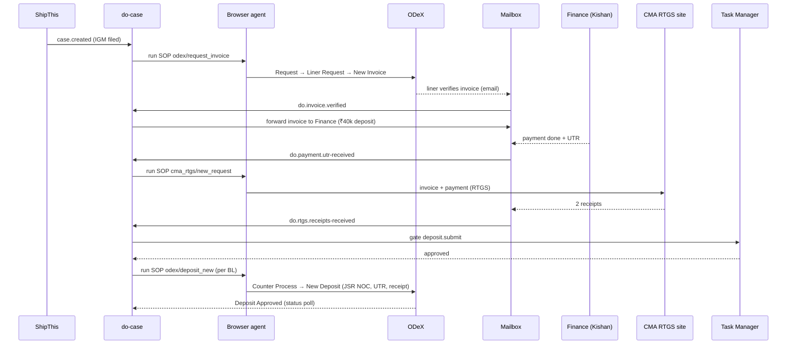

# DO Workflow Automation — Low-Level Design (LLD)

| | |
|---|---|
| Status | Draft v0.1 |
| Companion | [HLD.md](HLD.md) — read first for scope, actors and open questions |
| Conventions | Mirrors `logistics-platform-1/python-brain`: Beanie models, Inngest factory functions, `EventNames` constants, YAML SOPs with explicit `method:`, kebab-case step names, ruff (line length 100), mypy strict, pytest `asyncio_mode=auto` |

> **Read [ENGINE-REUSE.md](ENGINE-REUSE.md) first.** It was written after reading the `python-brain` code and corrects this document in two places: §1 below is a layout sketch only (the engine is copied, not redrawn), and §4.2 now uses the engine's event-chained pattern instead of a single orchestrator. §4.3's stage functions map 1:1 to the chain in §4.2; read its "invoked" trigger column as "triggered by the preceding event".

Anything marked **[TBD]** depends on an open question in HLD §12 and is a config value or a one-file change, not a redesign.

---

## 1. Package layout

> The authoritative tree is in [REPO-STRUCTURE.md](REPO-STRUCTURE.md) §2: everything below lives under `backend/`, and the dashboard under `frontend/`.

```
src/do_workflow_automation/
├── main.py                       # FastAPI app, lifespan (Mongo init, Inngest register, Graph renewal)
├── config.py                     # pydantic-settings; every env var lives here
├── events.py                     # EventNames (customs/do.<entity>.<action>)
├── api/
│   ├── deps.py                   # get_current_user (JWT)
│   └── routers/                  # cases.py  tasks.py  documents.py  webhooks.py  admin.py
├── domain/
│   ├── states.py                 # CaseState, DoRequestState, transition table
│   ├── models/                   # Beanie documents (§2)
│   └── services/                 # case_service, task_service, sla_service
├── workflows/                    # Inngest functions (§4)
│   ├── do_case.py                # orchestrator
│   ├── invoice.py  finance.py  rtgs.py  deposit.py
│   ├── docs_folder.py  do_request.py  edo.py  refund.py
│   ├── chase.py  sla_sweeper.py  erp_poll.py
│   └── task_gate.py              # wait_for_task_approval / signal_task_done
├── email/
│   ├── ingest.py                 # Graph webhook → classify → route
│   ├── classifier.py             # deterministic rules → LLM second pass
│   ├── extractors.py             # UTR, invoice no., amount, MBL/HBL
│   ├── matcher.py                # email → case
│   └── send.py                   # forward-to-finance, chase, notifications
├── documents/
│   ├── registry.py               # loads documents.yaml → DocumentSpec
│   ├── generators/               # bond, noc_cha, noc_hexalog, authorization_letter, checklist
│   ├── classifier.py             # attachment → doc_type
│   ├── verifier.py               # same-shipment checks, flags
│   └── assembler.py              # ordered merge → single PDF
├── agents/browser/               # lifted from python-brain (core, nodes, integrations, utils)
├── sops/
│   ├── odex/                     # login, request_invoice, deposit_new, do_request_new, refund_request, status_*
│   └── cma_rtgs/                 # new_request
├── connectors/
│   ├── shipthis.py  outlook.py  slack.py  extend_ai.py
└── shared/                       # idempotency, locks, hitl, alerts, logging, redaction
config/
├── documents.yaml                # §6.1
├── gates.yaml                    # §7
└── sla.yaml                      # §9
tests/
```

Import style: the package is installed (`src` layout, `uv_build`), so imports are `from do_workflow_automation.x import …`. Do not copy `python-brain`'s `sys.path` trick.

## 2. Data model (MongoDB, Beanie)

### 2.1 `do_cases` — one per MBL

| Field | Type | Notes |
|---|---|---|
| `_id` | ObjectId | |
| `mbl_no` | str, unique | e.g. `GGZ3193024` |
| `shipment_id` | ObjectId? | link to `python-brain`/ShipThis shipment if present |
| `liner` | enum `CMA_CGM` | extension point |
| `state` | `CaseState` | §3 |
| `container_nos` | list[str] | `TCNU5191327` |
| `vessel`, `voyage` | str | `OOCL SINGAPORE`, `0FBI5W1MA` |
| `consignee_mbl` | str | as per MBL |
| `cha` | str | `JAY SHRIRAM DARBAR LOGISTICS (P) LTD` |
| `igm_filed_at` | datetime? | trigger |
| `invoice` | `{odex_ref, invoice_no, amount, deposit_amount=40000, verified_at}` | |
| `payment` | `{utr, paid_at, mode: NEFT\|RTGS, finance_msg_id}` | |
| `rtgs` | `{submitted_at, reference, receipt_doc_ids[]}` | |
| `deposit` | `{odex_ref, status: pending\|submitted\|approved\|rejected, approved_at}` | |
| `refund` | `{requested_at, due_by, status, bank_account_ref}` | `due_by = requested_at + 14d` |
| `hbls` | list[`HblRef`] | `{hbl_no, consignee_hbl, do_request_state, odex_do_ref}` |
| `run_ids` | dict | latest Inngest run per stage, for dashboard deep-links |
| `created_at`, `updated_at`, `version` | | optimistic concurrency |

Indexes: `mbl_no` unique; `state`; `hbls.hbl_no`; `(state, updated_at)` for sweepers.

### 2.2 `do_documents` — every file, source preserved

| Field | Notes |
|---|---|
| `case_id`, `hbl_no?` | `hbl_no` null = MBL-level |
| `doc_type` | `bond_consignee`, `bond_client`, `hbl`, `mbl`, `security_receipt`, `security_odex_receipt`, `do_receipt`, `noc_do_cha`, `endorsed_do`, `noc_do_hexalog`, `authorization_letter`, `checklist` — from `documents.yaml` |
| `source` | `system` \| `email` \| `odex` |
| `source_ref` | email message id + attachment id, or generator name + template version |
| `storage_uri`, `sha256`, `bytes`, `pages` | original file, never rewritten |
| `extracted` | `{mbl_no?, hbl_no?, job_no?, container_no?, consignee?, utr?, …}` |
| `verification` | `{status: ok\|mismatched\|unreadable, reasons[], checked_at}` |
| `flag` | `none\|missing\|duplicate\|mismatched`; `flag_cleared_by`, `flag_cleared_at`, `flag_note` |
| `superseded_by` | for replaced files (keeps audit chain) |

Index: `(case_id, doc_type, hbl_no)`; `sha256` for duplicate detection.

### 2.3 `do_folders` — the assembled PDF per HBL

`{case_id, hbl_no, document_ids[] (ordered), pdf_uri, pdf_sha256, built_at, built_from_config_version, operator_confirmed_by, operator_confirmed_at}`.
A folder is **immutable** once `operator_confirmed_*` is set; a change creates a new folder version.

### 2.4 `do_events` — append-only audit

`{case_id, ts, actor: system|user:<email>|email:<msg>, type, from_state, to_state, data, run_id}`.
All state transitions, gate decisions, flag clearances, submissions and received emails write here. No updates, no deletes.

### 2.5 Reused collections (unchanged semantics from `python-brain`)

`hitl_requests`, `idempotency_keys` (with the `parked` state), `automation_runs` (browser run + screenshots), `tasks`, `users`, `outbound_emails`, `erp_outbox`, `function_runs`.

## 3. State machine

Transitions are a table in `domain/states.py`; `case_service.transition(case, to, actor, data)` is the **only** writer of `state`. It validates the edge, writes `do_events`, updates the case with a version check, and emits `customs/do.case.state-changed`.

```python
class CaseState(StrEnum):
    CREATED = "created"
    INVOICE_REQUESTED = "invoice_requested"
    INVOICE_VERIFIED = "invoice_verified"
    AWAITING_PAYMENT = "awaiting_payment"
    PAID = "paid"
    RTGS_SUBMITTED = "rtgs_submitted"
    RECEIPTS_RECEIVED = "receipts_received"
    DEPOSIT_REQUESTED = "deposit_requested"
    DEPOSIT_APPROVED = "deposit_approved"
    DOCS_IN_PROGRESS = "docs_in_progress"
    DOCS_REVIEW = "docs_review"
    DOCS_READY = "docs_ready"
    DO_REQUESTED = "do_requested"
    EDO_RECEIVED = "edo_received"
    COMPLETED = "completed"
    REFUND_REQUESTED = "refund_requested"
    REFUNDED = "refunded"
    CANCELLED = "cancelled"
    PARKED = "parked"          # unrecoverable; explicit operator action to un-park

ALLOWED: dict[CaseState, set[CaseState]] = {
    CREATED: {INVOICE_REQUESTED, CANCELLED},
    INVOICE_REQUESTED: {INVOICE_VERIFIED, PARKED, CANCELLED},
    INVOICE_VERIFIED: {AWAITING_PAYMENT},
    AWAITING_PAYMENT: {PAID, PARKED},
    PAID: {RTGS_SUBMITTED, PARKED},
    RTGS_SUBMITTED: {RECEIPTS_RECEIVED, PARKED},
    RECEIPTS_RECEIVED: {DEPOSIT_REQUESTED},
    DEPOSIT_REQUESTED: {DEPOSIT_APPROVED, PARKED},
    DEPOSIT_APPROVED: {DOCS_IN_PROGRESS},
    DOCS_IN_PROGRESS: {DOCS_REVIEW, DOCS_READY},
    DOCS_REVIEW: {DOCS_IN_PROGRESS},
    DOCS_READY: {DO_REQUESTED},
    DO_REQUESTED: {EDO_RECEIVED, PARKED},
    EDO_RECEIVED: {COMPLETED},
    COMPLETED: {REFUND_REQUESTED},
    REFUND_REQUESTED: {REFUNDED, PARKED},
}
```

**Per-HBL sub-state** (`HblRef.do_request_state`): `pending → docs_ready → submitted → edo_received`. The case advances to `DO_REQUESTED` when the first HBL is submitted and to `EDO_RECEIVED` only when **all** HBLs have their eDO (SOP: *"More HBLs under MBL? Yes → repeat for next HBL"*).

> `DOCS_IN_PROGRESS`/`DOCS_READY` are case-level; per-HBL readiness is tracked on `HblRef`, and the case is `DOCS_READY` when every HBL folder is confirmed.

## 4. Workflows (Inngest)

Pattern per function: `create_<name>_function(client)` factory, registered in `main.py`; event names from `EventNames`; step names kebab-case and stable across replays; every side-effecting step wrapped in an idempotency claim; failures from browser SOPs raise `NonRetriableError`.

### 4.1 Event catalogue (`events.py`)

| Event | Emitted by | Consumed by |
|---|---|---|
| `customs/do.case.created` | `erp_poll`, `POST /cases`, IGM-filed email | `do-case` orchestrator |
| `customs/do.case.state-changed` | `case_service` | dashboard, sweeper |
| `customs/do.invoice.verified` | `email.ingest` (liner "invoice verified" mail) | `do-case` (wait) |
| `customs/do.payment.utr-received` | `email.ingest` (Finance mail with UTR) | `do-case` (wait) |
| `customs/do.rtgs.receipts-received` | `email.ingest` (2 receipts attached) | `do-case` (wait) |
| `customs/do.deposit.approved` | `deposit` status poll / ODeX email | `do-case` (wait) |
| `customs/do.document.received` | `email.ingest` | `docs-folder` |
| `customs/do.docs.ready` | `docs-folder` | `do-case` |
| `customs/do.request.submitted` | `do-request` | `edo` |
| `customs/do.edo.received` | `email.ingest` (endorsed DO) | `edo` / `do-case` |
| `customs/do.refund.due` | `refund` timer | `chase` |
| `customs/task.completed` | `POST /tasks/{id}/action` | gates |
| `customs/hitl.step.failed` / `.resolved` | any | HITL handler |

### 4.2 Orchestration model — event-chained, not a master orchestrator

> **Corrected after reading `python-brain`'s code** (see [ENGINE-REUSE.md](ENGINE-REUSE.md) §1). An earlier draft of this section described one `do-case` function using `step.invoke` and `step.wait_for_event`. The engine does not work that way, and we keep its pattern.

Each stage below is a small Inngest function, **triggered by an event**, that does one stage of work, writes its result and milestone to MongoDB, signals/completes its Task, and emits the next event with `client.send(inngest.Event(name=…, data=with_trace({...}, current_trace_id())))`. The Mongo record plus the Task list is the state; there is no in-process saga to lose.

| Waiting on… | Idiom (same as `python-brain`) |
|---|---|
| Ops approval, parks mid-function | `await wait_for_task_approval(ctx, shipment_oid, task_key)` (7 d) — used before the deposit submit and during document review |
| Ops approval, no timeout to outlive | a function **triggered by `customs/task.completed`** filtered on `event.data.task_key` — used for the DO-request submit (the `cmc_transmit` pattern) |
| An e-mail from Finance / CMA | the ingest function classifies it, matches it to the record, writes the fact (UTR, receipt, eDO) and emits the next stage's event — the next stage is simply *triggered by that event* |
| A reply on a thread we sent | `conversation_id` lookup in ingest → `…_REPLIED` event (as `CHECKLIST_CLIENT_REPLIED`) |
| Time passing / chasing | a **delayed event** (as `CHECKLIST_FOLLOW_UP_DUE`): attempt counter in the payload, max N attempts, then ops alert |
| One browser session per portal | `concurrency=[inngest.Concurrency(limit=1, scope="env", key='"odex-browser"')]` |
| Double submit | `claim_*` insert-once `IdempotencyKey` (`scope:key`), `fail_*_claim` on error; recovery = verify in the portal, delete the key, re-send the event |

Stage chain (event → function → emits):

```
customs/do.case.created ........ do-request-invoice ... → (liner e-mail) …
customs/do.invoice.verified .... do-send-finance ...... → (Finance e-mail) …
customs/do.payment.utr-received  do-rtgs-submit ....... → (receipts e-mail) …
customs/do.rtgs.receipts-received  do-deposit-request (task-gated) → customs/do.deposit.submitted
customs/do.deposit.submitted ... do-deposit-status (poll via delayed events) → customs/do.deposit.approved
customs/do.deposit.approved .... do-folder-open → generates system docs, emits per HBL
customs/do.document.received ... do-folder-collect → customs/do.folder.verify
customs/do.folder.verify ....... do-folder-verify → flags? review task : customs/do.folder.ready
customs/do.folder.ready ........ (task odex_do_request approved → task.completed)
customs/task.completed[odex_do_request]  do-request-submit → customs/do.request.submitted
customs/do.edo.received ........ do-edo → all HBLs? customs/do.case.completed
customs/do.case.completed ...... do-refund-request (task-gated) → delayed customs/do.refund.due
```

State lives in the Mongo record (`do` sub-document or `do_cases`, see ENGINE-REUSE §4.1) and the seeded Task list; `case_service.transition` from §3 remains the single writer of the state field, and each function above calls it at its boundaries.

### 4.3 Stage functions

| Function | Trigger | Steps (`ctx.step.run` names) | Output |
|---|---|---|---|
| `do-invoice` | invoked | `load-case` → `claim:do_invoice_request:{mbl}` → `run-odex-request-invoice` (SOP) → `persist-invoice-ref` → `transition` | `invoice.odex_ref`; state `INVOICE_REQUESTED` |
| `do-finance` | invoked | `load-invoice-email` → `build-finance-mail` → `claim:do_finance_mail:{mbl}` → `send-finance-mail` → `transition` | Graph message to Finance; state `AWAITING_PAYMENT` |
| `do-rtgs` | invoked with UTR | `claim:do_rtgs_submit:{mbl}` → `run-rtgs-new-request` (SOP) → `transition RTGS_SUBMITTED` | RTGS reference |
| `do-deposit` | invoked | `claim:do_deposit:{mbl}:{bl}` per BL → `run-odex-deposit-new` (SOP, one row per BL; consignee-refund vs third-party chosen from config) → `transition DEPOSIT_REQUESTED` | ODeX deposit ref |
| `do-deposit-status` | invoked | loop of `run-odex-status-deposit` every N min up to `deposit_approval_timeout`; on timeout → `chase` | state `DEPOSIT_APPROVED`, security slip saved as `security_odex_receipt` |
| `do-docs-folder` | invoked per HBL | `generate-system-docs` → `collect-email-docs` → `classify-and-verify` → (if flags) `create-review-task` + `wait-task` → `assemble-pdf` → `operator-confirm` → `upload-folder-to-erp` | `do_folders` row |
| `do-request` | invoked per HBL | `claim:do_request_submit:{hbl}` → `run-odex-do-request-new` (SOP: HBL no., not MBL) → `send-do-request-mail` → `run-odex-verify-do-request` → `transition HBL submitted` | `odex_do_ref` |
| `do-edo` | `customs/do.edo.received` | `match-case-hbl` → `store-endorsed-do` → `mark-hbl-edo` → (all HBLs?) `transition EDO_RECEIVED/COMPLETED` → `push-to-erp` | |
| `do-refund` | `COMPLETED` + refund trigger | `gather-3-docs` → `claim:do_refund:{mbl}` → `run-odex-refund-request` → arm 14-day timer → `refund-sla-check` | state `REFUND_REQUESTED → REFUNDED` |
| `do-chase` | invoked / timer | `build-chase-mail` → `claim` (dedup per `{case, stage, day}`) → `send` | Graph message to CMA |
| `do-sla-sweeper` | cron `*/15` | query cases past SLA per `sla.yaml` → emit `customs/do.sla.breached`, Slack alert, create Task | |
| `do-erp-poll` | cron `*/15` | find new CMA CGM shipments with IGM filed → upsert case → `customs/do.case.created` | |

### 4.4 Sequence — happy path through the money steps



## 5. Email pipeline

### 5.1 Ingest and routing

Same as `python-brain`: Graph webhook → `EmailService:InboundMessage` → `do-email-classify-and-route`. Mailbox: `do@hexalog.in` **[TBD]** (or tag-routed on the shared datahub mailbox). Subscription renewal job and a `reconcile` sweep on Graph `lifecycleEvent: missed`.

**Classifier** — deterministic rules first, LLM (OpenRouter, Haiku-class) only for the remainder. Classes relevant here:

| Class | Deterministic signals (examples, tune on real mail) | Event |
|---|---|---|
| `do_invoice_verified` | From CMA/ODeX domain; subject/body matches "invoice" + "verified"/"approved"; has PDF with `Delivery Deposit` | `do.invoice.verified` |
| `do_payment_utr` | From Finance; contains UTR token (§5.2) | `do.payment.utr-received` |
| `do_rtgs_receipt` | From CMA RTGS sender; ≥1 PDF; "receipt" | `do.rtgs.receipts-received` (after 2 receipts) |
| `do_security_receipt` / `do_odex_receipt` / `do_receipt` | From Kishan / Cust-ops; attachment classifier | `do.document.received` |
| `do_hbl` / `do_mbl` | Attachment classifier | `do.document.received` |
| `do_edo` | From CMA; "endorsed"/"e-DO"/"delivery order" | `do.edo.received` |

Anti-misroute rules carried over from `python-brain`: an explicit hashtag/ref in subject wins; never classify a reply to our own forward as a new invoice; never treat a pending "will pay" as a UTR.

### 5.2 Extractors (`extractors.py`)

```python
UTR_RE = re.compile(r"\b(?:UTR(?:\s*(?:No\.?|Number|#))?\s*[:\-]?\s*)([A-Z]{4}[A-Z0-9]{12,18}|\d{12,22})\b", re.I)
MBL_RE = re.compile(r"\b[A-Z]{3,4}\d{7,10}\b")        # e.g. GGZ3193024 — validate against case.mbl_no
HBL_RE = re.compile(r"\bMSEC\d{12}\b")                # e.g. MSEC260803047251 — prefix per consignee [TBD]
```

Extractors return `(value, confidence, evidence_span)`. Anything not **exact-match against an open case** is a candidate, not a fact. PDFs go through `document_reader` / Extend.ai for text; scanned pages fall back to OCR.

### 5.3 Matching an email to a case (`matcher.py`)

1. Hidden-span ref in a reply to our own mail (`do-case:<case_id>`) → exact case.
2. MBL/HBL/Job-No found in subject, body or attachment text **and** present in `do_cases` → case (HBL maps to its MBL).
3. Container no. + vessel/voyage → case, flagged lower confidence.
4. Otherwise → `HitlRequest(request_type="match_case")`, emailed to Ops with the hidden-span ref; their reply resumes the run via `HITL_RESOLUTION_RECEIVED`.

A message that matches more than one open case is never auto-routed.

### 5.4 Outbound mail (`send.py`)

| Mail | To | Content | Idempotency key |
|---|---|---|---|
| Forward invoice to Finance | Finance DL | Original CMA invoice attached, **₹40,000 security deposit** called out in the body, MBL/BL no., due-by, "reply with UTR", hidden-span case ref | `do_finance_mail:{mbl}` |
| DO request notification | CMA / liner contact **[TBD]** | HBL, ODeX ref, folder PDF | `do_request_mail:{hbl}` |
| Chase | CMA or Finance | Stage-specific template, escalating tone on day 2/4/7 | `do_chase:{case}:{stage}:{day}` |
| Ops review / HITL | Ops | Flag list and deep link | per `HitlRequest` |

All sends go through Graph with `outbound_emails` persistence for audit and reply threading.

## 6. Document service

### 6.1 `config/documents.yaml` — the single list SOP requirement 6 asks for

```yaml
version: 1
pdf_order: [bond_consignee, bond_client, hbl, mbl, security_receipt,
            security_odex_receipt, do_receipt, noc_do_cha,
            # [TBD] order for the four below — placed after the SOP's first 8 for now
            endorsed_do, noc_do_hexalog, authorization_letter, checklist]
documents:
  bond_consignee:        {no: 1,  source: system, generator: bond,        party: consignee, mandatory: true}
  bond_client:           {no: 2,  source: system, generator: bond,        party: client,    mandatory: true}
  hbl:                   {no: 3,  source: email,  per_hbl: true, mandatory: true, signature: "ENVOGUE sign"}
  mbl:                   {no: 4,  source: email,  multipage: true, mandatory: true, signature: "HEXALOG GLOBAL"}
  security_receipt:      {no: 5,  source: email,  senders: [kishan@hexalog.in, "{cust_ops}"], mandatory: true}
  security_odex_receipt: {no: 6,  source: email,  senders: [kishan@hexalog.in],             mandatory: true}
  do_receipt:            {no: 7,  source: email,  senders: [kishan@hexalog.in, "{cust_ops}"], mandatory: true}
  noc_do_cha:            {no: 8,  source: system, generator: noc,   format: cma_specific, signatory: "JAI SHRI",       mandatory: true}
  endorsed_do:           {no: 9,  source: email,  signature: "JAI SHRI",       mandatory: false}   # [TBD] mandatory?
  noc_do_hexalog:        {no: 10, source: system, generator: noc,   signatory: "HEXALOG GLOBAL",   mandatory: false}
  authorization_letter:  {no: 11, source: system, generator: auth_letter, signatory: "HEXALOG GLOBAL", mandatory: false}
  checklist:             {no: 12, source: system, generator: checklist,    mandatory: false}
match_rules:
  must_match_any_of: [mbl_no, hbl_no, job_no]
  mismatch_if_different: [mbl_no, hbl_no]
```

`mandatory` per row is **[TBD]** (HLD §12.2); the pipeline treats `mandatory: false` as "collect if present, don't block".

### 6.2 System-document generators

Each generator is `render(case, hbl) -> bytes`, HTML template → PDF via `weasyprint_pdf`, fields from the "Required Fields" table (MBL, container, HBLs, vessel, voyage, consignee per MBL / per HBL, CHA). Signature/stamp images are placed per `signature`/`signatory`. Template version is written to `source_ref`, so a re-render is reproducible.

### 6.3 Collection

`collect-email-docs`: for each `do_document.received` event matched to the case, run the attachment classifier (filename + first-page text + sender → `doc_type`), store the **original** bytes (sha256), create `do_documents`. System docs are generated once the case reaches `DEPOSIT_APPROVED` (or earlier, as soon as the data is present).

### 6.4 Verification (`verifier.py`)

Per HBL folder, compute a flag for each spec in `documents.yaml`:

| Flag | Rule |
|---|---|
| **missing** | `mandatory` doc has no `do_documents` row with a readable file |
| **duplicate** | ≥ 2 rows of the same `(doc_type, hbl_no)` with different `sha256` — or the same `sha256` uploaded twice |
| **mismatched** | extracted `mbl_no` / `hbl_no` / `job_no` conflicts with the case (any of `mismatch_if_different`), or none of `must_match_any_of` is found |
| **unreadable** | OCR/extraction failed → treated as missing for gating, with a distinct reason |

```python
def verify_folder(case, hbl, docs, spec) -> list[Flag]:
    flags = []
    for dt, s in spec.documents.items():
        rows = [d for d in docs if d.doc_type == dt and d.hbl_no in (None, hbl)]
        if not rows and s.mandatory:
            flags.append(Flag("missing", dt))
        if len(distinct_hashes(rows)) > 1 or len(rows) != len(distinct_hashes(rows)):
            flags.append(Flag("duplicate", dt))
        for r in rows:
            if conflicts(r.extracted, case, hbl, spec.match_rules):
                flags.append(Flag("mismatched", dt, reasons=diff(r.extracted, case, hbl)))
    return flags
```

Flags are **blocking**: the SOP forbids upload until all are cleared. The folder cannot reach `DOCS_READY` while any flag is open.

### 6.5 Operator review (G3)

`create-review-task` creates one Task per HBL with the flag list and links to each original. Ops can: attach/replace a file, mark a duplicate as superseded, override a mismatch **with a mandatory note**, or request a re-fetch. Every action writes `do_events` and the flag's `flag_cleared_by/at/note`. On task completion, `customs/task.completed` resumes the function, which re-runs `verify_folder` — an override never skips re-verification of the other docs.

### 6.6 Assembly (`assembler.py`)

`stitch_pdfs(paths_in_pdf_order, out)` from `pdf_stitcher`. Cover bookmarks per document name; page count and per-document page ranges stored in `do_folders`. After assembly, `operator-confirm` (single click) freezes the folder. Both the originals and the stitched PDF are retained.

## 7. Gates (`config/gates.yaml`)

```yaml
gates:
  finance.send:       {requires_ops_confirmation: false}   # G1
  deposit.submit:     {requires_ops_confirmation: true}    # G2
  docs.review:        {requires_ops_confirmation: true,  only_if: flags_present}   # G3
  do_request.submit:  {requires_ops_confirmation: true}    # G4
  refund.submit:      {requires_ops_confirmation: true}
```

Implemented with the same `wait_for_task_approval(ctx, case_oid, task_key, timeout=7d)` primitive; tasks with `requires_ops_confirmation: false` auto-complete so the call is safe everywhere.

## 8. Browser SOPs

Rules (from `python-brain`): every step sets `method: playwright` explicitly; credentials by env-var name (`ODEX_USERNAME`/`_PASSWORD`, `CMA_RTGS_*`); runtime params via `params.*`; a script step **throws** on bad state, which fails the run loudly instead of continuing blind. Selectors below are placeholders — they must be recorded against the live portals.

### 8.1 `odex/request_invoice.yaml` (SOP "Request Invoice")

```yaml
metadata: {name: "ODeX - Request DO Invoice", version: "1.0", retry_config: {max_retries: 2, retry_delay: 1.0}}
credentials: {username_env: ODEX_USERNAME, password_env: ODEX_PASSWORD}
steps:
  - {action: goto,  method: playwright, url: "{{ODEX_URL}}", wait_for: load}
  - {action: fill,  method: playwright, selector: "#username", value_from: credentials.username_env}
  - {action: fill,  method: playwright, selector: "#password", value_from: credentials.password_env}
  - {action: click, method: playwright, selector: "#login"}
  # Odex -> Request -> Liner Request -> Request New Invoice
  - {action: click, method: playwright, selector: "text=Request"}
  - {action: click, method: playwright, selector: "text=Liner Request"}
  - {action: click, method: playwright, selector: "text=Request New Invoice"}
  - {action: fill,  method: playwright, selector: "#mbl",       value_from: params.mbl_no}
  - {action: fill,  method: playwright, selector: "#container", value_from: params.container_no}
  - {action: click, method: playwright, selector: "#submit"}
  - {action: execute_script, method: playwright, script: "extract_request_ref"}   # throws if no ref shown
  - {action: end}
```

### 8.2 `cma_rtgs/new_request.yaml`

Navigates to the CMA India RTGS `Finance/RTGS/NewRequest` form, fills invoice no., amount, UTR, payment date, **the receipt e-mail address (dedicated mailbox [TBD])** and the case reference if the form allows one, submits, and captures the on-page acknowledgement as a screenshot saved to `do_documents` (`doc_type=rtgs_ack`). It does **not** need to read the receipts — they arrive by e-mail (§5).

### 8.3 `odex/deposit_new.yaml` — Counter Process → Deposit and Refund → New Deposit

Params: `bl_no`, `utr`, `payment_mode`, `bank_details`, `refund_to` (`consignee` | `third_party`), `noc_path` (JSR NOC), `security_receipt_path`. One run per BL when several BLs sit under one MBL (SOP: *"fill an entry for every BL"*). Steps: open menu → New Deposit → fill per-BL fields → choose refund target → upload NOC (**required when the payer is the consignee named in the MBL**) → enter UTR + bank/payment details → attach security receipt → submit → read ODeX ref and status; **throw** if the status isn't `Submitted`/`Deposit Approved`.

### 8.4 `odex/status_deposit.yaml`

Read-only lookup of the deposit's status by ODeX ref; returns `pending|approved|rejected`. Used by `do-deposit-status`. On `Deposit Approved` it also downloads the security slip copy → `security_odex_receipt` candidate document.

### 8.5 `odex/do_request_new.yaml` — e-Payment → DO Request → New DO Request

Params: `hbl_no` (**HBL, never MBL**), required DO fields, `folder_pdf_path`. Steps: login → menu → New DO Request → fill fields using the HBL number → *Add Row* → upload the folder PDF → Save → capture the DO request ref. Per-HBL: `do-request` is invoked once per HBL by the orchestrator.

### 8.6 `odex/refund_request.yaml`

Params: three file paths (**CMA receipt, ODeX confirmation receipt, security-deposit payment proof**) and `refund_bank_account`. Steps: menu → Deposit and Refund → Request Refund → *Amount Refunded* screen → attach all three **together** → enter bank account → submit → capture ref. After success, `do-refund` sets `refund.due_by = now + 14d`.

### 8.7 Runtime

`LangGraphReactAgent.execute_sop(...)` as in `python-brain`. Iteration caps: login-heavy SOPs 80, deposit/DO request 120, status polling 40. Screenshot on every failure; `AutomationRun` row per run. Run in Browserbase in prod, local Chromium in dev. A global **browser lock per portal** (ODeX) prevents two runs fighting over one session; the lock lives in Mongo with a TTL.

## 9. Timers & SLAs (`config/sla.yaml`)

| Stage | Soft alert | Chase | Park |
|---|---|---|---|
| Invoice verified by liner | 4 h | 1 d | 5 d |
| Finance pays (UTR) | 1 d | 2 d | 7 d |
| RTGS receipts | 4 h | 1 d | 5 d |
| Deposit Approved | 1 d | 2 d | 7 d |
| eDO received | 1 d | 1 d | 5 d |
| Refund | day 10 | day 14 | day 21 (escalate) |

Values are placeholders [TBD]. `do-sla-sweeper` is the only place that reads this table; workflows read their own timeout from the same config so they can't drift.

## 10. API (FastAPI, JWT)

This is the contract the `frontend/` consumes. FastAPI's OpenAPI schema is the source of truth; the frontend's typed client is generated from it (REPO-STRUCTURE §3). Document download links are short-lived signed URLs.

| Method & path | Purpose |
|---|---|
| `POST /api/v1/do/cases` | Create a case (manual or from ERP); idempotent on `mbl_no` |
| `GET /api/v1/do/cases` / `/{id}` | List (Kanban by state) / detail with documents, events, timers |
| `POST /api/v1/do/cases/{id}/actions` | `retry-stage`, `cancel`, `park`, `unpark`, `refetch-document` |
| `GET /api/v1/do/cases/{id}/documents` | Documents with flags |
| `POST /api/v1/do/cases/{id}/documents` | Operator upload / replace (writes `do_events`) |
| `POST /api/v1/do/cases/{id}/documents/{doc}/flag` | Clear/override a flag (note required) |
| `GET /api/v1/do/cases/{id}/folders/{hbl}/pdf` | Download stitched PDF |
| `GET /api/v1/tasks`, `POST /api/v1/tasks/{id}/action` | Task Manager (shared with `python-brain`) |
| `POST /api/v1/webhooks/microsoft-graph` | Graph notifications |
| `POST /api/v1/webhooks/extend-ai` | Document extraction results |
| `POST /api/v1/hitl/resolve` | HITL resolution |
| `POST /api/v1/admin/cases/ingest`, `GET /healthz` | Admin / health |

## 11. Configuration (env)

`MONGODB_URI`, `INNGEST_*`, `JWT_SECRET`, `GRAPH_TENANT_ID/CLIENT_ID/CLIENT_SECRET`, `DO_MAILBOX`, `FINANCE_DL`, `CUST_OPS_DL`, `KISHAN_EMAIL`, `SHIPTHIS_BASE_URL/TOKEN`, `ODEX_URL/USERNAME/PASSWORD`, `CMA_RTGS_URL/USERNAME/PASSWORD`, `EXTEND_API_KEY`, `OPENROUTER_API_KEY`, `USE_BROWSERBASE`, `BROWSERBASE_*`, `SLACK_WEBHOOK_URL`, `DO_DEPOSIT_AMOUNT=40000`, `DOC_STORE_URI`. All defined once in `config.py`; secrets never in YAML.

## 12. Error handling

| Failure | Behaviour |
|---|---|
| ODeX/RTGS SOP step fails | `NonRetriableError`, screenshot + `AutomationRun` saved, Slack + tech-alert, Task for Ops; recovery = re-fire the stage event (safe: idempotency + status re-read) |
| Idempotency key exists with `completed` | Step returns the stored result and does not act |
| Key `pending` older than TTL (in-flight crash) | **Do not auto-retry money steps**; park and require an operator to confirm external state first |
| Email can't be matched | HITL, never guessed |
| Extraction low confidence | Document marked `unreadable` → blocks as missing, surfaced in review task |
| Portal unreachable / maintenance | Retry with backoff (≤ 3), then SLA path |
| Graph webhook missed | `reconcile` sweep re-lists the mailbox since the last cursor |
| ERP write fails | `erp_outbox` retries with backoff; case progress is not blocked by ERP write-back |
| Operator marks wrong override | Overrides are append-only and reversible via a new `do_events` entry; folder versioning keeps the prior PDF |

Money-step rule: **a step that may have already moved money (RTGS submit, deposit submit) is never blindly retried** — it first checks the portal's own record for the case and reconciles.

## 13. Security & compliance

- Secrets from env/secret manager; `log_redaction` masks UTR, account numbers and tokens; `check_no_secret_logging.py` runs in CI.
- Ops endpoints JWT + role (`ops`, `finance_readonly`, `admin`).
- Document store private; signed URLs with short TTL; hashes recorded; originals immutable.
- Automation actions on portals are attributed (`actor: system`) in `do_events` with run id and screenshots, for audit.

## 14. Testing

| Layer | Approach |
|---|---|
| State machine | Property-style tests: every allowed edge passes, every other raises; `transition` is the only writer |
| Extractors / classifier | Golden-file tests from real (redacted) mails and PDFs; UTR/MBL/HBL regex fixtures with negatives |
| Verifier | Table-driven: missing / duplicate / mismatched / unreadable permutations on the 12-doc spec |
| Assembler | Stitch order and page-range assertions; re-assembly is byte-stable for the same inputs |
| Workflows | Inngest test harness with stubbed browser agent and connectors; assert step names stable across replay, idempotency prevents double submission |
| SOPs | Smoke tests against a recorded HTML fixture of each portal page; **live dry-run** against ODeX with gates on before enabling in prod |
| API | pytest + real local Mongo (skip if absent), same as `python-brain` |
| Contract | `EventNames` payload contracts asserted in tests |

CI (already in `.github/workflows/ci.yml`): `ruff check`, `ruff format --check`, `mypy` strict, `pytest` with coverage.

## 15. Build order (first vertical slice)

1. `config.py`, `events.py`, `CaseState` + `transition`, `do_cases` / `do_events` models, `POST/GET /cases`.
2. `documents.yaml` loader, `do_documents`, verifier, assembler, with fixture PDFs — **delivers Deliverable 2 on its own, no portal needed.**
3. Task gate + review task + operator flag clearing.
4. ShipThis read connector + `erp_poll` → case creation.
5. `odex/do_request_new` SOP + `do-request` (second-highest manual effort), behind G4.
6. Email ingest/classify/match + UTR/receipt flow, then `odex/request_invoice`, `cma_rtgs/new_request`, `odex/deposit_new`.
7. `edo`, `refund`, SLA sweeper, dashboards.
